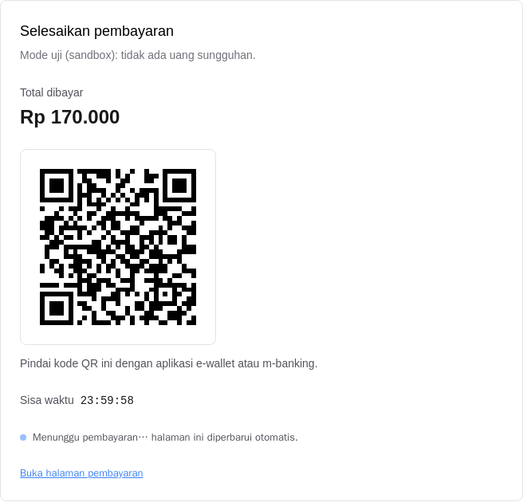
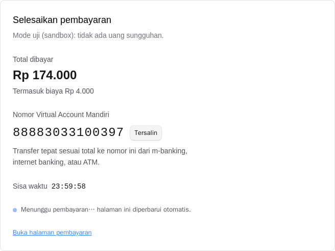

# doit.id checkout for the Medusa Next.js Starter

Drop-in files for [`nextjs-starter-medusa`](https://github.com/medusajs/nextjs-starter-medusa)
(tested against commit `9818886`, Next.js 15, Medusa 2.19) that add a doit.id payment step:

- **Pick a method**: QRIS or a Virtual Account bank. Only methods doit.id has active for your key are
  listed, each with the fee for this cart (`GET /store/doit/methods`).
- **QRIS**: renders `qr_content` as an SVG QR code ([`qrcode.react`](https://www.npmjs.com/package/qrcode.react), no canvas, no network).
- **Virtual Account**: shows the number with a copy button.
- **Countdown** to `expires_at`.
- **Polling** of `GET /store/doit/carts/:id/payment`. When the payment is paid, the order is placed and the
  shopper lands on the starter's confirmation page. This works even when webhooks can't reach you
  (e.g. on localhost).
- **Hosted page**: a link to doit.id's `hosted_url`. Set `NEXT_PUBLIC_DOIT_REDIRECT_TO_HOSTED=true` to send
  shoppers there straight away. They come back to the review step through `return_url`.

The styling is plain: the starter's Tailwind tokens and `@medusajs/ui`, with no logos or brand colours. All
text is in [`labels.ts`](src/modules/checkout/components/doit-payment/labels.ts) (Indonesian), so you can
restyle or translate it in one place.

| QRIS | Virtual Account |
| --- | --- |
|  |  |

## Install

1. Install and configure the plugin in your Medusa backend (see the main README). Enable the provider
   `pp_doit_doit` in your IDR region.
2. In the storefront:

   ```bash
   npm install qrcode.react@^4.2.0
   ```

3. Copy `src/` from this folder over your storefront's `src/`. It only adds new files:

   ```
   src/lib/data/doit.ts                                     server actions (SDK calls)
   src/modules/checkout/components/doit-payment/index.tsx   isDoit, DoitPaymentButton
   src/modules/checkout/components/doit-payment/rail-picker.tsx
   src/modules/checkout/components/doit-payment/payment-panel.tsx
   src/modules/checkout/components/doit-payment/labels.ts   all shopper-facing text
   src/modules/checkout/components/doit-payment/format.ts   rupiah + countdown helpers
   ```

4. Wire it into three starter files. Either apply the patch:

   ```bash
   git apply path/to/examples/nextjs-starter/starter.patch
   ```

   or make the same changes by hand:

   **`src/lib/constants.tsx`**: add the provider to `paymentInfoMap`:

   ```tsx
   pp_doit_doit: { title: "QRIS / Virtual Account", icon: <CreditCard /> },
   ```

   **`src/modules/checkout/components/payment/index.tsx`**: show the method picker and pass the choice
   when the session is created:

   ```tsx
   import { DoitChoice, selectDoitMethod } from "@lib/data/doit"
   import { DoitRailPicker, isDoit } from "@modules/checkout/components/doit-payment"

   const [doitChoice, setDoitChoice] = useState<DoitChoice | null>(/* from activeSession.data */)

   // in handleSubmit, before the generic initiatePaymentSession call:
   if (isDoit(selectedPaymentMethod)) {
     const res = await selectDoitMethod(cart, selectedPaymentMethod, doitChoice!,
       `${window.location.origin}${pathname}?step=review`)
     if (!res.ok) throw new Error(res.message)
   } else if (!checkActiveSession) { /* starter code */ }

   // under the <RadioGroup>:
   {isDoit(selectedPaymentMethod) && (
     <DoitRailPicker cartId={cart.id} value={doitChoice} onChange={setDoitChoice} />
   )}
   ```

   **`src/modules/checkout/components/payment-button/index.tsx`**: add a case to the switch:

   ```tsx
   case isDoit(paymentSession?.provider_id):
     return <DoitPaymentButton cart={cart} notReady={notReady} />
   ```

## How it behaves

| Backend `next_action` | Panel |
| --- | --- |
| `wait` | Shows QR / VA, countdown, hosted link; polls again after `poll_after_ms` (5 s). Pauses while the tab is hidden. |
| `complete_cart` | Payment is paid: calls the starter's `placeOrder()`, which completes the cart and redirects. |
| `view_order` | The webhook already completed the cart: `placeOrder()` returns that same order and redirects. |
| `retry` | Expired or failed: offers "Buat tagihan baru" (new invoice with the same method). |

The status endpoint only answers for a cart that belongs to the publishable key's sales channel. If the
cart belongs to a registered customer, that customer has to be logged in. Requests are rate limited
(40/min per cart, 120/min per IP), and the backend reads doit.id at most once per 10 s per payment. A
shopper who changes method gets a new invoice. The old one is not cancelled at doit.id (there is no
cancel endpoint) and simply expires.

Community plugin, not an official doit.id product.
